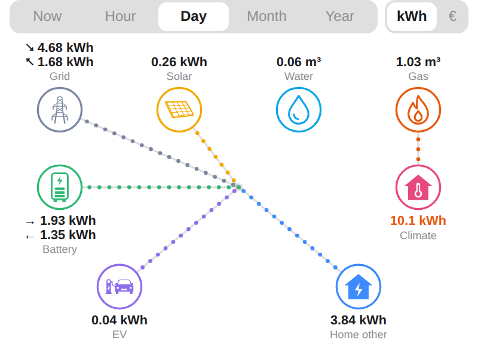
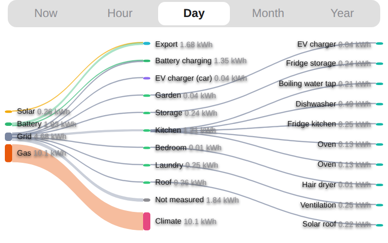
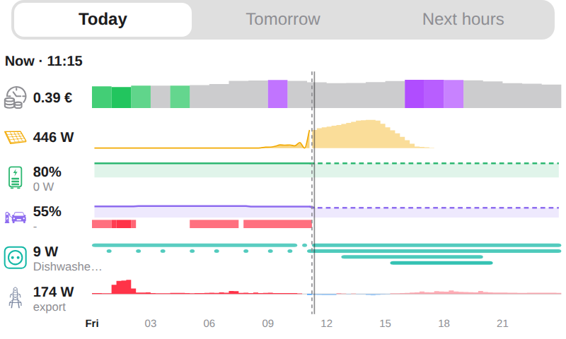
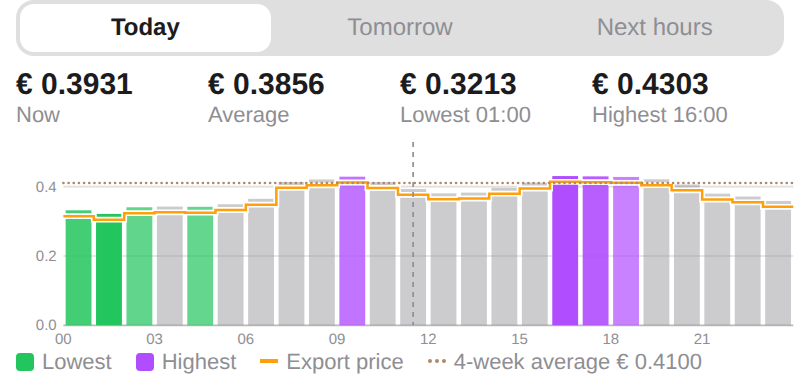
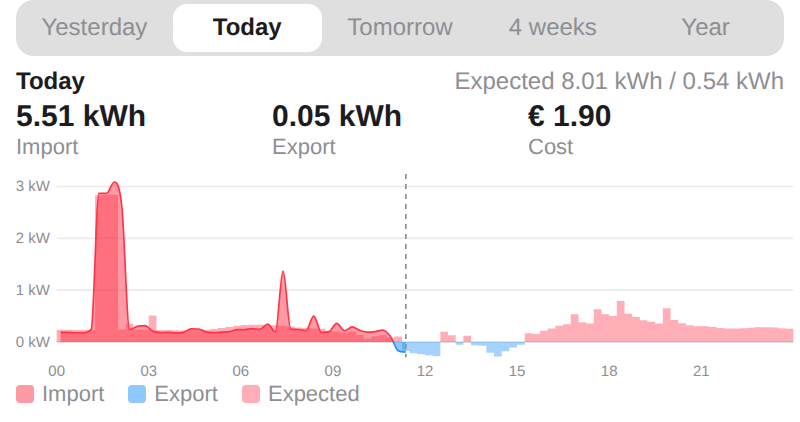
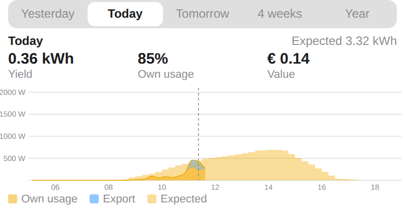
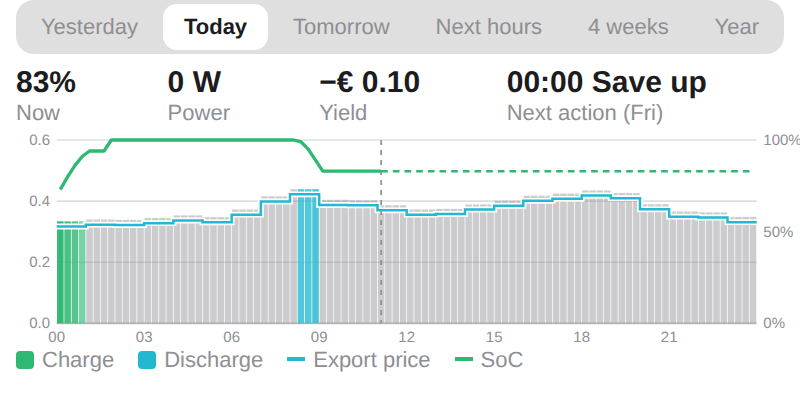
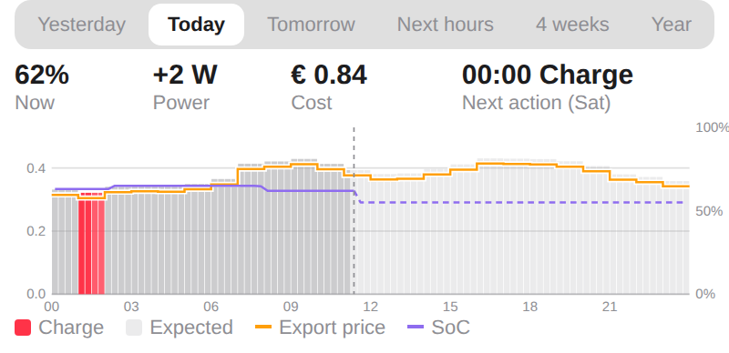

# 📱 Widgets

**Your energy at a glance, on a Homey dashboard.**
[← Overview](../README.md)

---

## Add a widget

1. Homey app → **Dashboards** → edit → **+** → **Power by the Hour**.
2. Pick a widget, and a device if it asks for one. Done.

- **Shape:** Normal or Widescreen.
- **Start tab:** the tab it opens on. Default: the last one you chose.
- **Tap or drag** in a chart: shows that slot or bar. Tap elsewhere: the whole period again.
- Text and numbers follow your Homey's language.
- New widget? It may first show **Building history…** for a few minutes.

---

## The widgets

| Widget | Shows | Needs |
|---|---|---|
| **Energy** | Grid, home, solar, battery, EV, climate, gas and water: kWh and money | Grid Monitor |
| **Energy flows** | Where your energy comes from and goes | Grid Monitor |
| **Energy plan** | Prices, solar, home load and the battery/EV plan | Grid Monitor |
| **Price** | Prices per slot, coloured cheap to dear | Energy Price device |
| **Grid** | Import, export and costs; expected for today | Grid Monitor |
| **Solar** | Forecast and measured, yield, own use and value | Solar Monitor |
| **Battery** | Charge, discharge, charge level and plan | Smart Battery |
| **EV charger** | Charging, charge level and plan | Smart EV Charger |

**Tabs**
- Energy, Energy flows: Now, Hour, Day, Month, Year.
- Energy plan, Price: Today, Tomorrow, Next hours.
- Grid, Solar: Yesterday, Today, Tomorrow, 4 weeks, Year.
- Battery, EV charger: also Next hours.

---

## Screenshots

**Energy**

**Energy flows**

**Energy plan**

**Price**

**Grid**

**Solar**

**Battery**

**EV charger**

---

## Settings per widget

- **Energy:** Show gas, Show water, Gas kWh per m³ (shows gas in kWh).
- **Energy flows:** Show gas, Gas kWh per m³, Split home into zones (your Power Monitors per Homey zone), Add Homey Energy to zones (also devices without a Power Monitor). Pick devices to show only those.
- **Price:** Show 4-week average. No prices yet? Tap **Turn on forecast** for AI prices.
- **Solar:** pick one or more Solar Monitors; they are added up.
- **Battery / EV charger:** pick the device.

---

## Good to know

- **Energy flows detail:** flows under 2% are hidden. Tap the right half for more detail (down to 0.5%), the left half for less (up to 10%). Kept per tab.
- **Climate:** Power Monitors with **Heating or cooling** ticked, plus gas.
- **Home other:** home use minus climate.
- **Pale bars:** expected values. **Estimated:** a gap in the history is filled in.
- Graphs and widgets use the same colours. **Red:** charging, import, use. **Blue:** discharging, export. **Green / purple:** lowest / highest prices.
- The dashboard's edit mode blocks taps on widgets. Tap **Done** first.
